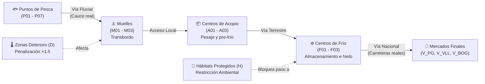

# 🐟 Optimización de Centros de Refrigeración para Pesca Artesanal
### *Modelado Multimodal de Redes Logísticas mediante Teoría de Grafos y Optimización de la Cadena de Frío en Puerto Gaitán, Meta (Colombia)*

---

## 📑 Resumen Ejecutivo

En la región de Puerto Gaitán (Meta, Colombia), la pesca artesanal sobre los ríos **Meta**, **Manacacías** e **Iteviare** representa el sustento económico de múltiples asociaciones pesqueras. Sin embargo, las altas temperaturas ambientales promedio de la Orinoquía (~30 °C a 36 °C) y la carencia de infraestructura frigorífica en los puntos de captura generan tasas de descomposición bacteriana aceleradas. Históricamente, esto provoca pérdidas postcosecha superiores al **25% - 40%** del producto antes de llegar a los mercados de abasto regional (Villavicencio) o nacional (Bogotá).

Este proyecto implementa una solución de ingeniería integral fundamentada en **Estructuras de Datos y Algoritmos Avanzados**, modelando la cadena de suministro como un **grafo dirigido ponderado multimodal** (redes fluviales y red vial nacional/terciaria). El sistema:
1. **Determina la ubicación óptima de centros de refrigeración** (Facility Location Problem - FLP).
2. **Genera itinerarios logísticos realistas** que obligan a consolidar la captura en centros de acopio mediante transporte fluvial y carretero.
3. **Evita deliberadamente zonas de hábitat protegido** y penaliza tramos críticos de deterioro térmico.
4. **Calcula costos operativos, peajes, mermas por temperatura y tiempos efectivos** bajo una función de costo multicriterio de 6 factores y 22 variables operativas.
5. **Implementa todos los algoritmos de grafos desde cero** (sin librerías prefabricadas de grafos como NetworkX para el cálculo), garantizando rigor académico e independencia tecnológica.

---

## 🏛️ Arquitectura del Modelo Logístico

El flujo del producto sigue estrictamente la jerarquía física de la cadena de frío:

$$\text{Punto de Pesca } (P) \xrightarrow[\text{Río}]{\text{Lancha}} \text{Muelle } (M) \xrightarrow[\text{Vía Terciaria}]{\text{Campero/Moto}} \text{Acopio } (A) \xrightarrow[\text{Vía Secundaria}]{\text{Furgón Ligero}} \text{Centro de Frío } (F) \xrightarrow[\text{Carretera Nacional}]{\text{Furgón Térmico/Isotérmico}} \text{Mercado } (V)$$



---

## 🗺️ Topología de la Red: Nodos y Conexiones

La red se compone de **18 nodos estratégicos** y **41 conexiones dirigidas**:

### 1. Tipología de Nodos
* **Puntos de Pesca ($P$):** 7 asociaciones y desembarcaderos reales (P01: ASOPESGA, P02: Atarraya Verde, P03: Asovida San Miguel, P04: Asopespor, P05: Puerto Trujillo, P06: Desembarcadero Central Puerto Gaitán, P07: Soplaviento).
* **Muelles Fluviales ($M$):** Infraestructura de atraque en orilla (M01: Río Meta Alto, M02: Río Meta Central, M03: Puerto Gaitán Malecón).
* **Centros de Acopio ($A$):** Instalaciones intermedias para recepción y clasificación (A01: San Miguel, A02: Río Manacacías, A03: Puerto Trujillo).
* **Centros de Frío ($F$):** Nodos con capacidad frigorífica instalada o candidatos para apertura (F01: Alto Neblinas, F02: Puerto Gaitán casco urbano, F03: Puerto López).
* **Zonas de Deterioro ($D$):** Puntos críticos expuestos a demoras extremas o radiación térmica que multiplican la tasa de merma biológica (D01: Ruta Sur, D02: Sabana Alta).
* **Hábitats Protegidos ($H$):** Humedales y zonas de desove protegidas por normatividad ambiental (H01: Humedal Río Meta, H02: Ronda Hídrica Manacacías).
* **Puntos de Venta y Mercados ($V$):** Comercios físicos reales georreferenciados (V_PG1: Llanofish, V_PG2: El Pavón en Puerto Gaitán; V_VLL: Amigos de la Pesca en Villavicencio; V_BOG1: Buceo y Pesca en Chapinero, V_BOG2: Aqualand Sports en La Castellana, Bogotá).

---

## 📐 Formulación Matemática y Variables del Sistema

El modelo integra **22 variables operativas y físicas** en cada arco $(i, j)$ del grafo:

### Inventario de las 22 Variables

| # | Variable | Símbolo / Código | Unidad | Descripción |
|---|---|---|---|---|
| 1 | Distancia Física | $d_{ij}$ | $\text{km}$ | Longitud geográfica real (geometría vial OSRM o meandros fluviales). |
| 2 | Tiempo Base de Viaje | $t_{ij}$ | $\text{horas}$ | Tiempo de tránsito nominal a velocidad estándar del tramo. |
| 3 | Tiempo de Espera | $t_{esp}$ | $\text{horas}$ | Espera en muelles por transbordo, peajes o congestión de carga. |
| 4 | Tiempo Efectivo | $t_{ef}$ | $\text{horas}$ | $t_{ef} = (t_{ij} \times \text{factor\_flujo}) + t_{esp}$. |
| 5 | Costo Base de Transporte | $C_{trans}$ | $\text{COP}$ | Costo operacional por flete vehicular o fluvial ($d_{ij} \times \$3,500/\text{km}$). |
| 6 | Número de Peajes | $n_{peaje}$ | Entero | Cantidad de estaciones de peaje en la ruta vial. |
| 7 | Costo de Peajes | $C_{peaje}$ | $\text{COP}$ | Tarifa real acumulada ($n_{peaje} \times \$12,000$). |
| 8 | Costo Total del Tramo | $C_{tot}$ | $\text{COP}$ | $C_{tot} = C_{trans} + C_{peaje}$. |
| 9 | Tipo de Vía | $\text{tipo}$ | Categórica | `fluvial`, `acceso_local`, `terrestre`. |
| 10 | Estado de la Vía | $\text{estado}$ | Categórica | `buena` ($1.0$), `regular` ($1.5$), `mala` ($2.0$). |
| 11 | Flujo Vehicular | $\text{flujo}$ | Categórica | `bajo` ($1.0$), `medio` ($1.15$), `alto` ($1.35$). |
| 12 | Confiabilidad de la Vía | $\text{conf}$ | $[0, 1]$ | Probabilidad de tránsito sin bloqueos o cierres no programados. |
| 13 | Probabilidad de Retraso | $P_{ret}$ | $[0, 1]$ | Susceptibilidad a detenciones imprevistas. |
| 14 | Riesgo Térmico | $R_{term}$ | $[0, 1]$ | Exposición a calor radiante sin aislamiento térmico. |
| 15 | Riesgo de Accidentes | $R_{acc}$ | $[0, 1]$ | Siniestralidad estadística del corredor. |
| 16 | Riesgo de Derrumbes | $R_{der}$ | $[0, 1]$ | Susceptibilidad geológica (ej. vía Villavicencio–Bogotá). |
| 17 | Riesgo Combinado | $R_{comb}$ | $[0, 1]$ | $0.50 R_{term} + 0.25 R_{acc} + 0.25 R_{der}$. |
| 18 | Restricción de Peso | $\text{ton}_{max}$ | $\text{ton}$ | Capacidad portante máxima de puentes o barcazas. |
| 19 | Restricción de Horario | $\text{horario}$ | Categórica | `ninguno`, `nocturno`, `diurno`. |
| 20 | Capacidad de Carga | $\text{cap}_{kg}$ | $\text{kg}$ | Capacidad volumétrica del vehículo/embarcación asignada. |
| 21 | Pérdida Esperada | $L_{ij}$ | $\%$ | Porcentaje de producto deteriorado acumulado en el tramo. |
| 22 | Peso Multicriterio | $w_{ij}$ | Adimensional | Costo ponderado global normalizado para optimización. |

---

### Ecuaciones Matemáticas Principales

#### 1. Función de Costo Multicriterio de los Arcos
Para evitar optimizar únicamente por distancia o tiempo, cada arista posee un costo global balanceado:

$$w_{ij} = \alpha \left(\frac{t_{ef}}{48}\right) + \beta \left(\frac{C_{tot}}{5{,}000{,}000}\right) + \gamma R_{comb} + \delta \left(\frac{L_{ij}}{100}\right) + \epsilon (1 - \text{conf}) + \zeta P_{ret}$$

**Ponderadores asignados:**
* $\alpha = 0.25$ (Tiempo de tránsito)
* $\beta = 0.20$ (Costo financiero)
* $\gamma = 0.20$ (Riesgo combinado)
* $\delta = 0.10$ (Merma esperada de calidad)
* $\epsilon = 0.10$ (Incertidumbre / Falta de confiabilidad)
* $\zeta = 0.05$ (Probabilidad de retrasos)

#### 2. Modelo de Deterioro Térmico y Pérdida Postcosecha
Basado en cinéticas de degradación bacteriana según guías FAO:

$$L_{ij} = \min\left( \text{TasaBase} \times t_{ef} \times \text{FactorEstadoVia} \times \left[1 + 0.5(1 - \text{conf})\right] \times \left[1 + 0.3 P_{ret}\right] \times \Phi_D, \; 100 \right)$$

* $\text{TasaBase} = 2.5\% \text{ por hora}$ a temperatura ambiente promedio ($30\ ^\circ\text{C}$).
* Si el tramo culmina o atraviesa una **Zona de Deterioro ($D$)**, se aplica un factor multiplicador severo: $\Phi_D = 1.5$.
* Si el tramo ingresa a un **Centro de Frío ($F$)** o **Acopio con refrigeración ($A$)**, el producto alcanza $0\ ^\circ\text{C}$ y el cronómetro de exposición térmica crítica se reinicia a cero ($t_{\text{sin\_frío}} = 0$).

#### 3. Optimización de Localización de Centros (Facility Location Problem - FLP)
Minimiza el número de centros frigoríficos a abrir sujetos a una ventana térmica máxima admisible ($T_{max} = 4.0\text{ horas}$):

$$\min \sum_{j \in J} y_j$$

Sujeto a:
$$\sum_{j \in J} x_{ij} = 1 \quad \forall i \in I \quad \text{(Cada pescador es cubierto por un centro)}$$
$$x_{ij} \le y_j \quad \forall i \in I, \; j \in J \quad \text{(Solo se asigna a centros abiertos)}$$
$$t_{ij} \cdot x_{ij} \le T_{max} \quad \forall i \in I, \; j \in J \quad \text{(Restricción de umbral térmico)}$$
$$y_j, x_{ij} \in \{0, 1\}$$

---

## 💻 Algoritmos Propios Implementados

En estricto cumplimiento pedagógico y de arquitectura, no se utilizaron bibliotecas de cajas negras para el cómputo de caminos:

```
src/algorithms/
├── dijkstra.py         -> Caminos mínimos con Cola de Prioridad (Min-Heap binario nativo heapq). O((V + E) log V).
├── bellman_ford.py     -> Caminos mínimos con detección formal de ciclos negativos y parada temprana. O(V * E).
└── floyd_warshall.py   -> Matriz de distancias de todos contra todos y reconstrucción de rutas. O(V^3).
```

### Gestión de Restricciones Ambientales
Los tres algoritmos incluyen el parámetro `evitar_restringidos: bool = True`:
* Si un nodo intermedio tiene marcado `restriccion_ambiental = True` (Nodos tipo $H$), el algoritmo invalida la transición en el paso de relajación, obligando a rodear el área protegida sin violar la legalidad ecológica.

---

## 🌊 Integración Geoespacial Real

### 1. Grafo Fluvial Topológico (`river_network.py`)
* Procesa el archivo cartográfico oficial `data/shapefiles/rios.shp` mediante `geopandas` y `shapely`.
* Genera una malla de segmentos fluviales reales uniendo vértices coincidentes por proximidad geodésica (Haversine).
* Permite a las lanchas navegar el curso curvo y sinuoso de los ríos Meta y Manacacías, calculando la distancia hidrológica real en lugar de saltos en línea recta.

### 2. Geometría Vial OSRM (`route_geometry.py`)
* Conexión con la API de Open Source Routing Machine (OSRM) para extraer el trazado exacto de las curvas de las carreteras colombianas (Ruta 40 hacia Villavicencio y Bogotá).
* Sistema de persistencia local en caché (`data/output/rutas_cache.json`) que almacena las coordenadas de los 48 tramos para permitir ejecuciones veloces y sin consumo de cuota de red.

---

## 📊 Itinerarios Logísticos Resultantes hacia Bogotá

Al ejecutar el planificador global (`itinerarios.py`), se obtienen las rutas consolidadas reales:

| Origen | Ruta Logística Multimodal | Distancia | Tiempo | Pérdida Final | Detalle Operativo |
|---|---|---|---|---|---|
| **P01** (Alto Neblinas) | $P01 \xrightarrow{\text{río}} A02 \rightarrow F02 \rightarrow F03 \rightarrow V\_BOG1$ | 306.5 km | 7.05 h | **16.7%** | Fluvial por Manacacías $\rightarrow$ Acopio A02 $\rightarrow$ Cadena nacional. |
| **P02** (Atarraya Verde) | $P02 \rightarrow A02 \rightarrow F02 \rightarrow F03 \rightarrow V\_BOG1$ | 302.0 km | 6.85 h | **16.3%** | Acceso local rápido a Acopio Manacacías. |
| **P03** (Asovida) | $P03 \rightarrow A01 \rightarrow F02 \rightarrow F03 \rightarrow V\_BOG1$ | 305.0 km | 7.00 h | **16.6%** | Consolidación en Acopio San Miguel. |
| **P04** (Asopespor) | $P04 \rightarrow A01 \rightarrow F02 \rightarrow F03 \rightarrow V\_BOG1$ | 308.5 km | 7.15 h | **17.0%** | **Esquiva hábitat H01** (evita atajo prohibido). |
| **P05** (Puerto Trujillo) | $P05 \rightarrow A03 \rightarrow D01 \rightarrow M02 \rightarrow A01 \dots$ | 350.0 km | 9.20 h | **22.4%** | Tramo fluvial crítico + paso por zona D01. |
| **P06** (Desembarcadero) | $P06 \rightarrow F02 \rightarrow F03 \rightarrow V\_BOG1$ | 289.5 km | 6.38 h | **15.3%** | Desembarque directo en casco urbano de Puerto Gaitán. |
| **P07** (Soplaviento) | $P07 \rightarrow A02 \rightarrow F02 \rightarrow F03 \rightarrow V\_BOG1$ | 301.5 km | 6.85 h | **16.3%** | Navegación hacia Acopio A02 en Manacacías. |

---

## 🛠️ Estructura del Proyecto

```
Proyecto/
├── main.py                         # Orquestador del pipeline completo de 10 etapas
├── AGENTS.md                       # Protocolo de orquestación y gobernanza técnica
├── requirements.txt                # Dependencias (folium, geopandas, matplotlib, numpy, pytest)
├── setup.py                        # Metadatos del paquete v2.0.0
├── data/
│   ├── csv/                        # Tablas fuente de la red
│   │   ├── nodos_pesca.csv         # Puntos P de captura
│   │   ├── nodos_centros.csv       # Nodos F, A, M, D, H
│   │   ├── nodos_destinos.csv      # Mercados reales V
│   │   └── aristas.csv             # 41 aristas con las 22 variables
│   ├── shapefiles/                 # Cartografía oficial rios.shp/dbf/prj/shx/cst
│   ├── geojson/                    # 49 puntos de campo históricos de referencia
│   └── output/                     # Salidas generadas
│       ├── mapa_interactivo.html   # Visor web Folium interactivo
│       ├── rutas_cache.json        # Caché de geometrías OSRM y fluviales
│       ├── nodos_resultado.csv     # Exportación tabular de nodos procesados
│       └── aristas_resultado.csv   # Exportación tabular de aristas y costos
├── src/
│   ├── models/                     # Entidades de dominio (nodo.py, arista.py, grafo_logistico.py)
│   ├── algorithms/                 # Dijkstra, Bellman-Ford, Floyd-Warshall
│   ├── optimization/               # cold_chain.py, facility_location.py, itinerarios.py, scenario_evaluator.py
│   ├── visualization/              # folium_map.py, river_network.py, route_geometry.py, graph_plotter.py
│   └── utils/                      # constants.py, data_loader.py, geo_utils.py
└── tests/                          # 38 pruebas automatizadas unitarias y de integración
```

---

## 🚀 Guía de Instalación y Ejecución

### 1. Clonar y Configurar el Entorno

```powershell
# Clonar el repositorio
git clone <url-del-repositorio>
cd Proyecto

# Crear y activar entorno virtual (Recomendado)
python -m venv venv
.\venv\Scripts\activate

# Instalar dependencias
pip install -r requirements.txt
```

### 2. Ejecutar el Pipeline Completo

```powershell
python main.py
```
*(Para terminales PowerShell con filtros estrictos de stderr, se puede ejecutar `python main.py 2>$null`)*.

### 3. Visualizar el Mapa Interactivo en el Navegador

```powershell
Start-Process "data\output\mapa_interactivo.html"
```

### 4. Ejecutar la Suite de Pruebas

```powershell
python -m pytest tests/ -v
```
**Resultado esperado:** `38 passed in 3.9s` (100% de pruebas unitarias y de integración aprobadas).
